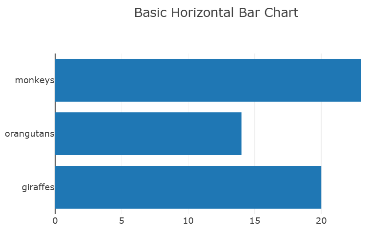
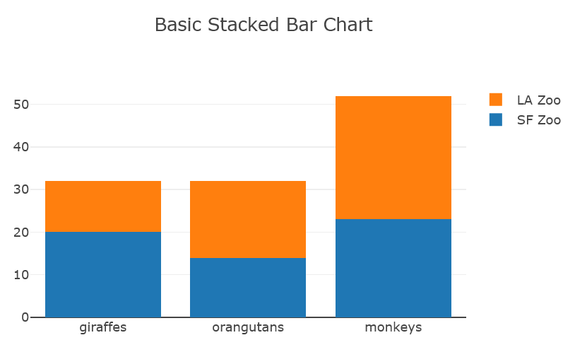
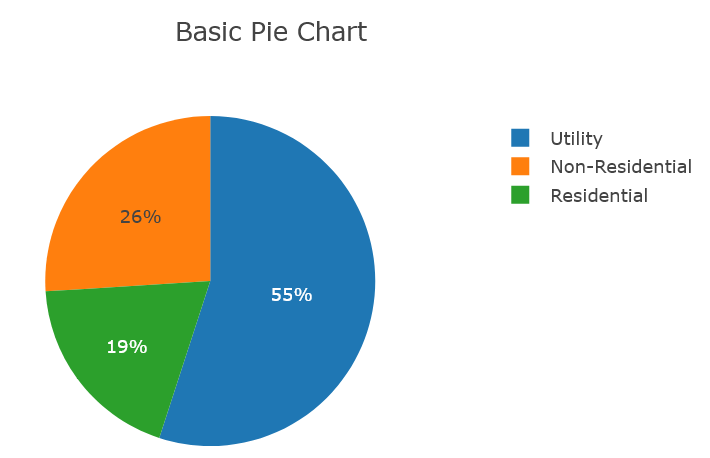
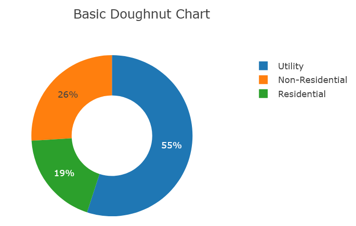

..  include:: ../../../Includes.txt

..  _screenShootsPlotlyCharts:

======
Plotly
======

Examples for the `Plotly` library are available in
:guilabel:`Resources/Private/Templates/PlotlyChartsExamples`.

The following screenshots were obtained
with the provided basic templates. Plotly offers 
many other features (see `Plotly Examples
<https://plotly.com/javascript/>`_).
       
Bar Charts
==========

..  figure:: ../../../Images/ScreenShots/PlotlyCharts/barChart.png
    :width: 50%

Horizontal charts, stacked charts
are special cases of bar charts.

Funnel Charts
=============

..  figure:: ../../../Images/ScreenShots/PlotlyCharts/funnelChart.png
    :width: 50%

Indicator Charts
================

..  figure:: ../../../Images/ScreenShots/PlotlyCharts/indicatorChart.png
    :width: 50%  
              
Line Charts
===========
        
..  figure:: ../../../Images/ScreenShots/PlotlyCharts/lineChart.png
    :width: 50%
            
Pie Charts   
==========

Doughnut charts
are special cases of pie charts.

        
Scatter Charts
==============
  
..  figure:: ../../../Images/ScreenShots/PlotlyCharts/scatterChart.png
    :width: 50%  

2D Contour and 3D surface with Data from Spreadsheets
=====================================================

..  figure:: ../../../Images/ScreenShots/PlotlyCharts/Gaussian2D.png
    :width: 50% 
    
..  figure:: ../../../Images/ScreenShots/PlotlyCharts/Surface3D.png
    :width: 50%  