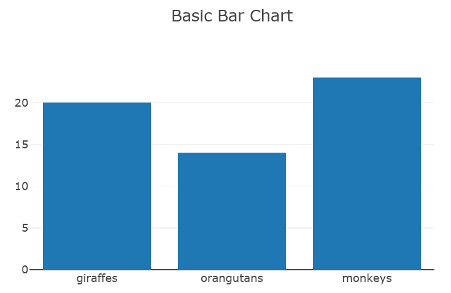

..  include:: ../../../../Includes.txt

..  _plotlychart.barViewHelper:

:navigation-title: plotlychart.bar

==================================
Bar ViewHelper <c:plotlychart.bar>
==================================

ViewHelper to include a bar chart with `Plotly`.

Go to the source code of this ViewHelper: 
`BarViewHelper.php
<https://github.com/YolfTypo3/SavCharts/blob/main/Classes/ViewHelpers/PlotlyChart/BarViewHelper.php>`_ (GitHub). 

Quick Test
==========

..  code-block:: xml 
    
    <c:template id="1">
    EXT:sav_charts/Resources/Private/Templates/PlotlyChartsExamples/BarChart.fluid"
    </c:template>

Arguments
=========

..  confval:: id
    :name: plotlychart.barId
    :Type: string
    :required: true
    
    Chart ID   
    
..  confval:: data
    :name: plotlychart.barData
    :Type: mixed
    :required: true

    Data, or a reference to data     
    
..  confval:: layout
    :name: plotlychart.barLayout
    :Type: mixed
    
    Layout, or a reference to layout    

..  confval:: config
    :name: plotlychart.barConfig
    :Type: mixed
    
    Config, or a reference to config  
        
..  confval:: width
    :name: plotlychart.barWidth
    :Type: string
    :Default: 600

    Width value, or a reference to the width value
        
..  confval:: height
    :name: plotlychart.barHeight
    :Type: string
    :Default: 400

    Height value, or a reference to the height value

Examples
========

Defining a Bar Chart
--------------------

..  code-block:: xml    

    <c:plotlycharts>
        <c:plotlychart.bar id="1" data="data__barChartData" layout="data__barChartLayout" >
            ...
        </c:plotlychart.bar>
    </c:plotlycharts>
    