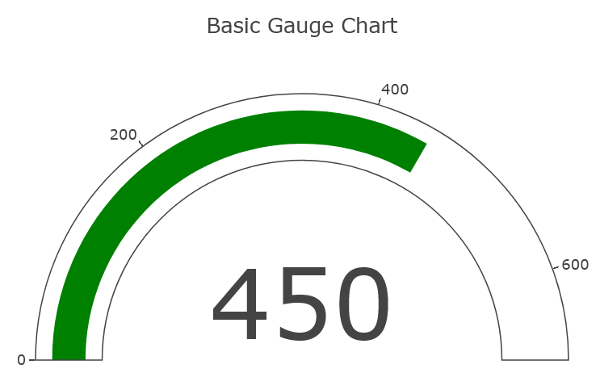

..  include:: ../../../../Includes.txt

..  _plotlychart.indicatorViewHelper:

:navigation-title: plotlychart.indicator

==============================================
Indicator ViewHelper <c:plotlychart.indicator>
==============================================

ViewHelper to include a gauge chart with `Plotly`.

Go to the source code of this ViewHelper: 
`IndicatorViewHelper.php
<https://github.com/YolfTypo3/SavCharts/blob/main/Classes/ViewHelpers/PlotlyChart/IndicatorViewHelper.php>`_ (GitHub). 

Quick Test
==========

..  code-block:: xml 
    
    <c:template id="1">
    EXT:sav_charts/Resources/Private/Templates/PlotlyChartsExamples/IndicatorChart.fluid"
    </c:template>

Arguments
=========

..  confval:: id
    :name: plotlychart.indicatorId
    :Type: string
    :required: true
    
    Chart ID    

..  confval:: data
    :name: plotlychart.indicatorData
    :Type: mixed
    :required: true

    Data, or a reference to data 
        
..  confval:: layout
    :name: plotlychart.indicatorLayout
    :Type: mixed
    
    Layout, or a reference to layout    

..  confval:: config
    :name: plotlychart.indicatorConfig
    :Type: mixed
    
    Config, or a reference to config 
        
..  confval:: width
    :name: plotlychart.indicatorWidth
    :Type: string
    :Default: 600

    Width value, or a reference to the width value
        
..  confval:: height
    :name: plotlychart.indicatorHeight
    :Type: string
    :Default: 400

    Height value, or a reference to the height value

Examples
========

Defining an Indicator Chart
---------------------------

..  code-block:: xml    

    <c:plotlycharts>
        <c:plotlychart.indicator id="1" data="data__indicatorChartData" data="data__indicatorChartData" layout="data__indicatorChartLayout" >
            ...
        </c:plotlychart.indicator>
    </c:plotlycharts>
    