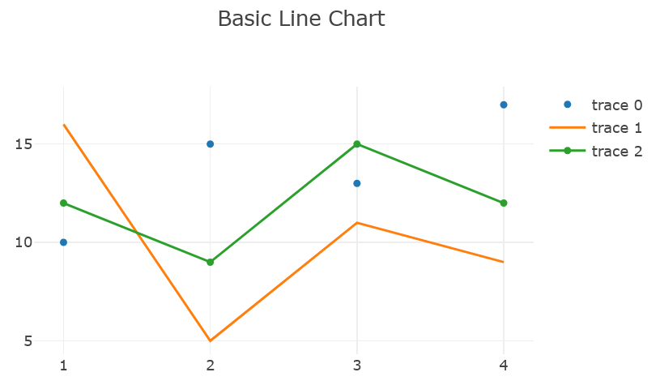

..  include:: ../../../../Includes.txt

..  _plotlychart.lineViewHelper:

:navigation-title: plotlychart.line

====================================
Line ViewHelper <c:plotlychart.line>
====================================

ViewHelper to include a line chart with `Plotly`.

Go to the source code of this ViewHelper: 
`LineViewHelper.php
<https://github.com/YolfTypo3/SavCharts/blob/main/Classes/ViewHelpers/PlotlyChart/LineViewHelper.php>`_ (GitHub). 

Quick Test
==========

..  code-block:: xml 
    
    <c:template id="1">
    EXT:sav_charts/Resources/Private/Templates/PlotlyChartsExamples/LineChart.fluid"
    </c:template>

Arguments
=========

..  confval:: id
    :name: plotlychart.lineId
    :Type: string
    :required: true
    
    Chart ID    

..  confval:: data
    :name: plotlychart.lineData
    :Type: mixed
    :required: true

    Data, or a reference to data 
        
..  confval:: layout
    :name: plotlychart.lineLayout
    :Type: mixed
    
    Layout, or a reference to layout    
   
..  confval:: config
    :name: plotlychart.lineConfig
    :Type: mixed
    
    Config, or a reference to config    
   
..  confval:: width
    :name: plotlychart.lineWidth
    :Type: string
    :Default: 600

    Width value, or a reference to the width value
        
..  confval:: height
    :name: plotlychart.lineHeight
    :Type: string
    :Default: 400

    Height value, or a reference to the height value

Examples
========

Defining a Line Chart
---------------------

..  code-block:: xml    

    <c:plotlycharts>
        <c:plotlychart.line id="1" data="data__lineChartData" layout="data__lineChartLayout" >
            ...
        </c:plotlychart.line>
    </c:plotlycharts>
    