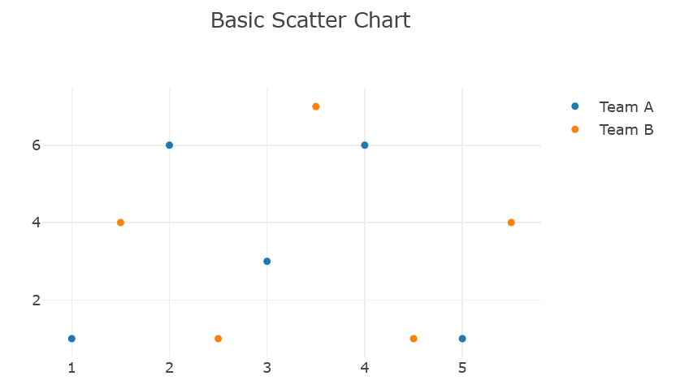

..  include:: ../../../../Includes.txt

..  _plotlychart.scatterViewHelper:

:navigation-title: plotlychart.scatter

==========================================
Scatter ViewHelper <c:plotlychart.scatter>
==========================================

ViewHelper to include a scatter chart with `Plotly`.

Go to the source code of this ViewHelper: 
`ScatterViewHelper.php
<https://github.com/YolfTypo3/SavCharts/blob/main/Classes/ViewHelpers/PlotlyChart/ScatterViewHelper.php>`_ (GitHub). 

Quick Test
==========

..  code-block:: xml 
    
    <c:template id="1">
    EXT:sav_charts/Resources/Private/Templates/PlotlyChartsExamples/ScatterChart.fluid"
    </c:template>

Arguments
=========

..  confval:: id
    :name: plotlychart.scatterId
    :Type: string
    :required: true
    
    Chart ID    
       
..  confval:: data
    :name: plotlychart.scatterData
    :Type: mixed
    :required: true

    Data, or a reference to data 
      
..  confval:: layout
    :name: plotlychart.scatterLayout
    :Type: mixed
    
    Layout, or a reference to layout    

..  confval:: config
    :name: plotlychart.scatterConfig
    :Type: mixed
    
    Config, or a reference to config  
        
..  confval:: width
    :name: plotlychart.scatterWidth
    :Type: string
    :Default: 600

    Width value, or a reference to the width value
        
..  confval:: height
    :name: plotlychart.scatterHeight
    :Type: string
    :Default: 400

    Height value, or a reference to the height value

Examples
========

Defining a Scatter Chart
------------------------

..  code-block:: xml    

    <c:plotlycharts>
        <c:plotlychart.scatter id="1" data="data__scatterChartData" layout="data__scatterChartLayout" >
            ...
        </c:plotlychart.scatter>
    </c:plotlycharts>
