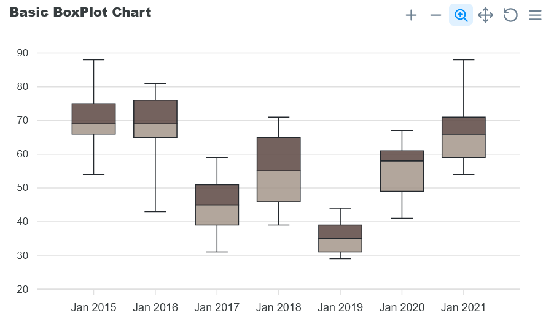
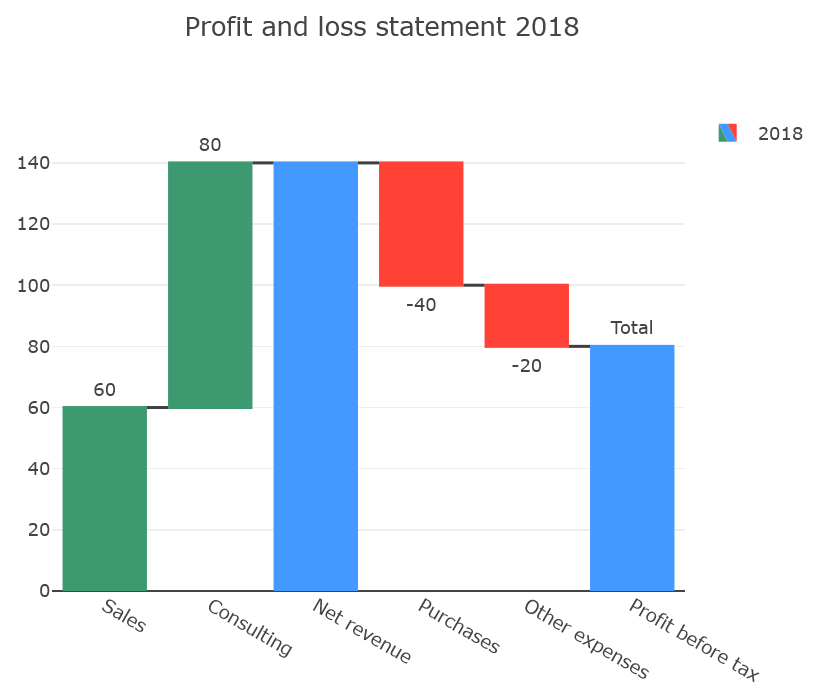
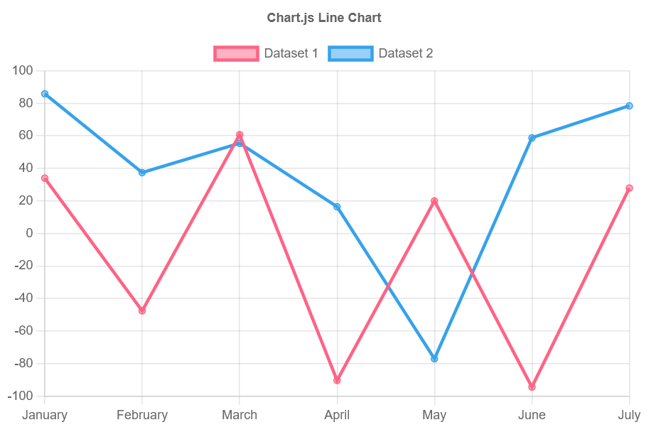

..  include:: ../../../Includes.txt

..  _UsingTheConverter:

===================
Using the Converter
===================

The converter, introduced in SAV Charts 14.9.0,
is a tool that automatically converts JavaScript
into Fluid Parser code. In most cases, the 
converter succeeds in the conversion process.
However, it is provided without a guarantee, and
specific cases where it fails may occur.

First, the JavaScript is converted into JSON by
iterative string replacements. Then, it is
decoded into an array using the json_decode() 
function. 

In case of success, the array is converted 
into Fluid Parser code, which is displayed in 
the Fluid Parser field. If there is an error
in json_decode(), all the replacement steps 
performed on the JavaScript are displayed in 
the Fluid Parser field. This can help detect 
where the conversion was not performed 
correctly.
    
If the conversion was successful, copy the
content from the Fluid Parser field and paste it
into a template or directly into a field on
the Fluid Parser tab. Where you paste the content
depends on the type of charts you are using and
on the structure of your project.

ApexCharts Example
==================

Assume you want to test the `ApexCharts basic 
boxplot <https://apexcharts.com/javascript-chart-demos/boxplot-charts/basic/>`_ example.

Copy the JavaScript code associated with the variable
options as shown below.

..  code-block:: javascript

    {
      series: [
        {
          type: 'boxPlot',
          data: [
            {
              x: 'Jan 2015',
              y: [54, 66, 69, 75, 88],
            },
            {
              x: 'Jan 2016',
              y: [43, 65, 69, 76, 81],
            },
            {
              x: 'Jan 2017',
              y: [31, 39, 45, 51, 59],
            },
            {
              x: 'Jan 2018',
              y: [39, 46, 55, 65, 71],
            },
            {
              x: 'Jan 2019',
              y: [29, 31, 35, 39, 44],
            },
            {
              x: 'Jan 2020',
              y: [41, 49, 58, 61, 67],
            },
            {
              x: 'Jan 2021',
              y: [54, 59, 66, 71, 88],
            },
          ],
        },
      ],
      chart: {
        type: 'boxPlot',
        height: 350,
      },
      title: {
        text: 'Basic BoxPlot Chart',
        align: 'left',
      },
      plotOptions: {
        boxPlot: {
          colors: {
            upper: '#5C4742',
            lower: '#A5978B',
          },
        },
      },
    }

Paste this code into the JavaScript field on
the Converter tab and click `Save`. The following
Fluid Parser code will appear in the Fluid
Parser field of the Converter tab.

..  code-block:: xml

    <c:item key="series">
        <c:item key="0">
            <c:item key="type" value="boxPlot" />
            <c:item key="data">
                <c:item key="0">
                    <c:item key="x" value="Jan 2015" />
                    <c:item key="y" values="54, 66, 69, 75, 88" />
                </c:item>
                <c:item key="1">
                    <c:item key="x" value="Jan 2016" />
                    <c:item key="y" values="43, 65, 69, 76, 81" />
                </c:item>
                <c:item key="2">
                    <c:item key="x" value="Jan 2017" />
                    <c:item key="y" values="31, 39, 45, 51, 59" />
                </c:item>
                <c:item key="3">
                    <c:item key="x" value="Jan 2018" />
                    <c:item key="y" values="39, 46, 55, 65, 71" />
                </c:item>
                <c:item key="4">
                    <c:item key="x" value="Jan 2019" />
                    <c:item key="y" values="29, 31, 35, 39, 44" />
                </c:item>
                <c:item key="5">
                    <c:item key="x" value="Jan 2020" />
                    <c:item key="y" values="41, 49, 58, 61, 67" />
                </c:item>
                <c:item key="6">
                    <c:item key="x" value="Jan 2021" />
                    <c:item key="y" values="54, 59, 66, 71, 88" />
                </c:item>
            </c:item>
        </c:item>
    </c:item>
    <c:item key="chart">
        <c:item key="type" value="boxPlot" />
        <c:item key="height" value="350" />
    </c:item>
    <c:item key="title">
        <c:item key="text" value="Basic BoxPlot Chart" />
        <c:item key="align" value="left" />
    </c:item>
    <c:item key="plotOptions">
        <c:item key="boxPlot">
            <c:item key="colors">
                <c:item key="upper" value="#5C4742" />
                <c:item key="lower" value="#A5978B" />
            </c:item>
        </c:item>
    </c:item>

Assume that the provided `GenericChart.fluid`
template is used. The data with ID `genericChartOptions`
should be set using the preceding code. To do 
so, fill out the following fields in the Fluid Parser
tab.

-   In the Data field

    ..  code-block:: xml    
        
        <c:data id="genericChartOptions">
            ###INCLUDE_CONVERTER###
        </c:data>        

-   In the Template field

    ..  code-block:: xml    

        <c:template id="1">
            EXT:sav_charts/Resources/Private/Templates/ApexChartsExamples/GenericChart.fluid"
        </c:template>  

..  note::
    
    Instead of using ###INCLUDE_CONVERTER### to
    include the Fluid Parser output, you can 
    paste the content directly inside
    `<c:data id="genericChartOptions"> ... </c:data>`.

Save, and go to the front-end.
    

    
Plotly Example
==============

Assume you want to test the `Plotly waterfall chart
<https://plotly.com/javascript/waterfall-charts/>`_ example,
using the provided `GenericChart.fluid`
template.

The variables `data` and `layout` must be
converted and the results must be set into the 
data with IDs `genericChartData` and
`genericChartLayout`.

Prepare the Fluid Parser tab fields with the 
following contents.

-   In the Data field

    ..  code-block:: xml    

        <c:data id="genericChartData">
        
        </c:data>

        <c:data id="genericChartLayout">
        
        </c:data>       

-   In the Template field

    ..  code-block:: xml    

        <c:template id="1">
            EXT:sav_charts/Resources/Private/Templates/PlotlyChartsExamples/GenericChart.fluid
        </c:template>

Then, copy the JavaScript code associated with 
the variable `data` as shown below.

..  code-block:: javascript

        [
            {
                name: "2018",
                type: "waterfall",
                orientation: "v",
                measure: [
                    "relative",
                    "relative",
                    "total",
                    "relative",
                    "relative",
                    "total"
                ],
                x: [
                    "Sales",
                    "Consulting",
                    "Net revenue",
                    "Purchases",
                    "Other expenses",
                    "Profit before tax"
                ],
                textposition: "outside",
                text: [
                    "+60",
                    "+80",
                    "",
                    "-40",
                    "-20",
                    "Total"
                ],          
                y: [
                    60,
                    80,
                    0,
                    -40,
                    -20,
                    0
                ],
                connector: {
                  line: {
                    color: "rgb(63, 63, 63)"
                  }
                },
            }
        ]    

Paste this code into the JavaScript field on
the Converter tab and click `Save`. The following
Fluid Parser code will appear in the Fluid
Parser field of the Converter tab.

..  code-block:: xml  

        <c:item key="0">
            <c:item key="name" value="2018" />
            <c:item key="type" value="waterfall" />
            <c:item key="orientation" value="v" />
            <c:item key="measure">
                <c:item key="0" value="relative" />
                <c:item key="1" value="relative" />
                <c:item key="2" value="total" />
                <c:item key="3" value="relative" />
                <c:item key="4" value="relative" />
                <c:item key="5" value="total" />
            </c:item>
            <c:item key="x">
                <c:item key="0" value="Sales" />
                <c:item key="1" value="Consulting" />
                <c:item key="2" value="Net revenue" />
                <c:item key="3" value="Purchases" />
                <c:item key="4" value="Other expenses" />
                <c:item key="5" value="Profit before tax" />
            </c:item>
            <c:item key="textposition" value="outside" />
            <c:item key="text">
                <c:item key="0" value="+60" />
                <c:item key="1" value="+80" />
                <c:item key="2" value="" />
                <c:item key="3" value="-40" />
                <c:item key="4" value="-20" />
                <c:item key="5" value="Total" />
            </c:item>
            <c:item key="y">
                <c:item key="0" value="60" />
                <c:item key="1" value="80" />
                <c:item key="2" value="0" />
                <c:item key="3" value="-40" />
                <c:item key="4" value="-20" />
                <c:item key="5" value="0" />
            </c:item>
            <c:item key="connector">
                <c:item key="line">
                    <c:item key="color" value="rgb(63, 63, 63)" />
                </c:item>
            </c:item>
        </c:item>

Copy this code and paste it into
`<c:data id="genericChartData"> ... </c:data>`.

Now, copy the JavaScript code associated with 
the variable `layout` as shown below. 
      
..  code-block:: javascript

        {
            title: {
                text: "Profit and loss statement 2018"
            },
            xaxis: {
                type: "category"
            },
            yaxis: {
                type: "linear"
            },
            autosize: true,
            showlegend: true
        }

Paste this code into the JavaScript field on
the Converter tab and click `Save`. The following
Fluid Parser code will appear in the Fluid
Parser field of the Converter tab.

..  code-block:: xml

        <c:item key="title">
            <c:item key="text" value="Profit and loss statement 2018" />
        </c:item>
        <c:item key="xaxis">
            <c:item key="type" value="category" />
        </c:item>
        <c:item key="yaxis">
            <c:item key="type" value="linear" />
        </c:item>
        <c:item key="autosize" value="true" />
        <c:item key="showlegend" value="true" /> 

Copy this code and paste it into
`<c:data id="genericChartLayout"> ... </c:data>`.
Save and go to the front-end.

Charts.js Example with JavaScript Functions
===========================================

Contrary to ECharts, ApexCharts, and Plotly the 
configuration of Charts.js includes a `type` field.
Therefore, only available templates can be used.

Assume you want to test the `Line chart
<https://www.chartjs.org/docs/latest/samples/line/line.html/>`_
example which contains calls to external JavaScript
functions and variables. They are defined in the 
provided file `Resources/Public/JavaScript/Charts/Extra/utils.js`.

Prepare the Fluid Parser tab fields with the 
following contents.

-   In the Data field

    ..  code-block:: xml    
        
        <c:data id="lineChartData">
        
        </c:data>

        <c:data id="lineChartOptions">
        
        </c:data>      

-   In the Template field

    ..  code-block:: xml    

        <f:asset.script identifier="utils" src="EXT:sav_charts/Resources/Public/JavaScript/Charts/Extra/utils.js" />

        <c:template id="1">
            EXT:sav_charts/Resources/Private/Templates/ChartsExamples/FluidParser/LineChart.fluid"
        </c:template>

..  note::
    
    As it can be seen, the file containing the
    JavaScript variables and functions is included
    using the Fluid viewHelper `<f:asset.script>`. 

Copy the JavaScript code associated with 
the variable `data` as shown below. 

..  code-block:: javascript

    {
      labels: labels,
      datasets: [
        {
          label: 'Dataset 1',
          data: Utils.numbers(NUMBER_CFG),
          borderColor: Utils.CHART_COLORS.red,
          backgroundColor: Utils.transparentize(Utils.CHART_COLORS.red, 0.5),
        },
        {
          label: 'Dataset 2',
          data: Utils.numbers(NUMBER_CFG),
          borderColor: Utils.CHART_COLORS.blue,
          backgroundColor: Utils.transparentize(Utils.CHART_COLORS.blue, 0.5),
        }
      ]
    }

Paste this code into the JavaScript field on
the Converter tab and click `Save`. The following
Fluid Parser code will appear in the Fluid
Parser field of the Converter tab.

..  code-block:: xml

    <c:item key="labels" value="{data__labels}" />
    <c:item key="datasets">
        <c:item key="0">
            <c:item key="label" value="Dataset 1" />
            <c:item key="data" callback="true">
                Utils.numbers(NUMBER_CFG)
            </c:item>
            <c:item key="borderColor" callback="true">
                Utils.CHART_COLORS.red
            </c:item>
            <c:item key="backgroundColor" callback="true">
                Utils.transparentize(Utils.CHART_COLORS.red, 0.5)
            </c:item>
        </c:item>
        <c:item key="1">
            <c:item key="label" value="Dataset 2" />
            <c:item key="data" callback="true">
                Utils.numbers(NUMBER_CFG)
            </c:item>
            <c:item key="borderColor" callback="true">
                Utils.CHART_COLORS.blue
            </c:item>
            <c:item key="backgroundColor" callback="true">
                Utils.transparentize(Utils.CHART_COLORS.blue, 0.5)
            </c:item>
        </c:item>
    </c:item>

Copy this code and paste it into
`<c:data id="lineChartData"> ... </c:data>`. 
As it can be seen, the JavaScript line `labels: labels,` is
converted into the reference `{data__labels}`. Therefore, a
data with an ID label must be defined. The data field of the
Fluid Parser tab must be modified as follows.

-   In the Data field

    ..  code-block:: xml    

        <c:data id="labels" callback="true">
            Utils.months({count: 7})
        </c:data>

        <c:data id="lineChartData">
            <c:item key="labels" value="{data__labels}" />
            <c:item key="datasets">
                <c:item key="0">
                    <c:item key="label" value="Dataset 1" />
                    <c:item key="data" callback="true">
                        Utils.numbers({count: 7, min: -100, max: 100})        
                    ...
        
        </c:data>

        <c:data id="lineChartOptions">
        
        </c:data>    

Now, copy the JavaScript code associated with 
the `options` field of the variable `config` as
shown below.

..  code-block:: javascript

    {
        responsive: true,
        plugins: {
          legend: {
            position: 'top',
          },
          title: {
            display: true,
            text: 'Chart.js Line Chart'
          }
        }
    }         

Paste this code into the JavaScript field on
the Converter tab and click `Save`. The following
Fluid Parser code will appear in the Fluid
Parser field of the Converter tab.

..  code-block:: xml  

    <c:item key="responsive" value="true" />
    <c:item key="plugins">
        <c:item key="legend">
            <c:item key="position" value="top" />
        </c:item>
        <c:item key="title">
            <c:item key="display" value="true" />
            <c:item key="text" value="Chart.js Line Chart" />
        </c:item>
    </c:item>    

Copy this code and paste it into
`<c:data id="lineChartOptions"> ... </c:data>`.
Save and go to the front-end. The chart will change each
time you reload the page because the data are 
generated randomly.

