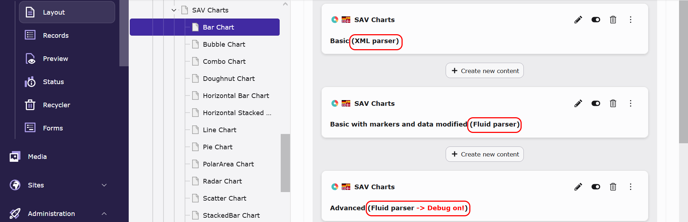
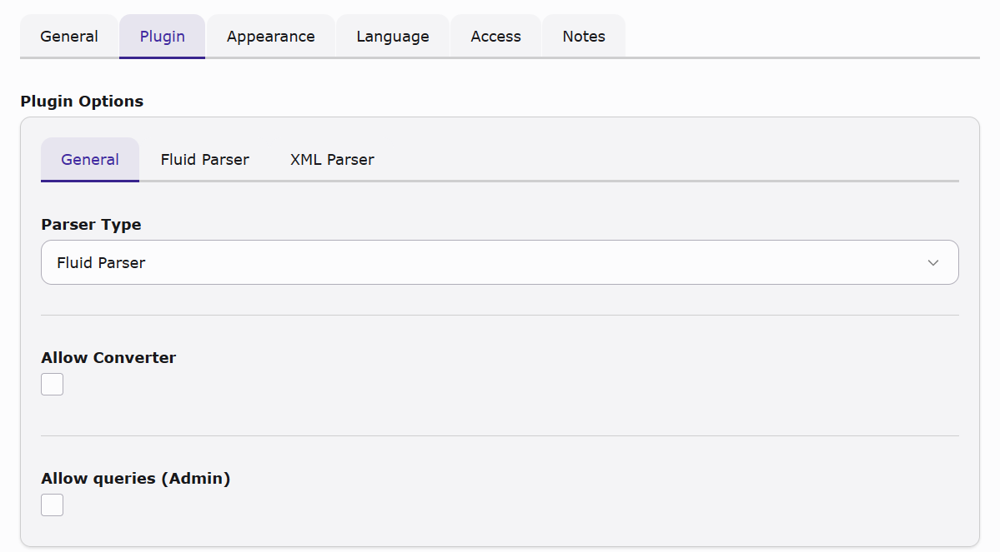
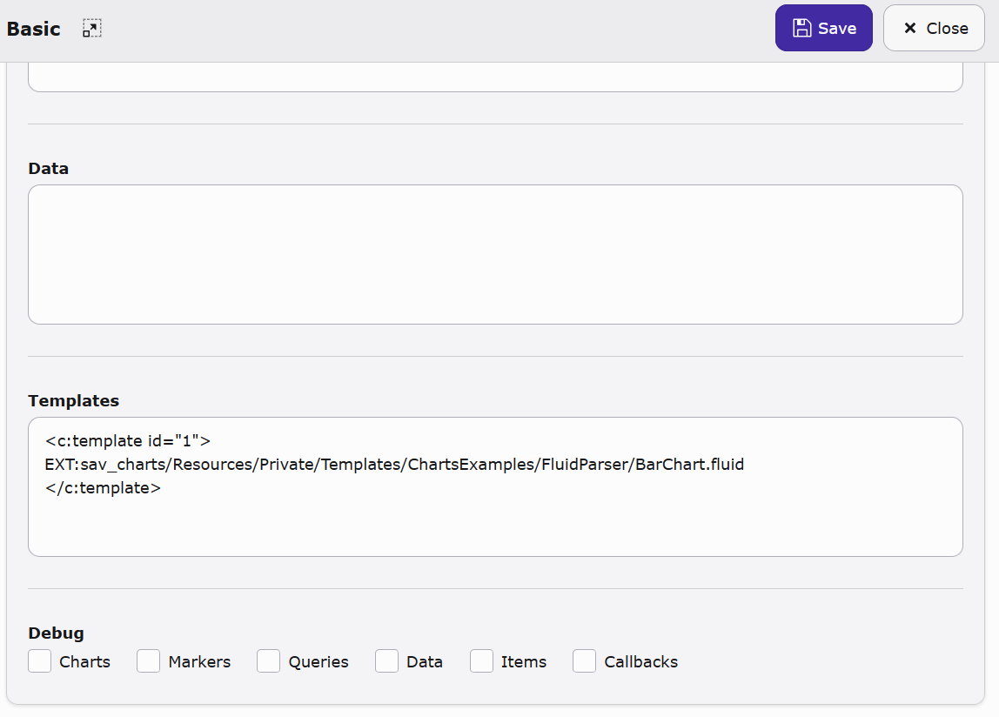
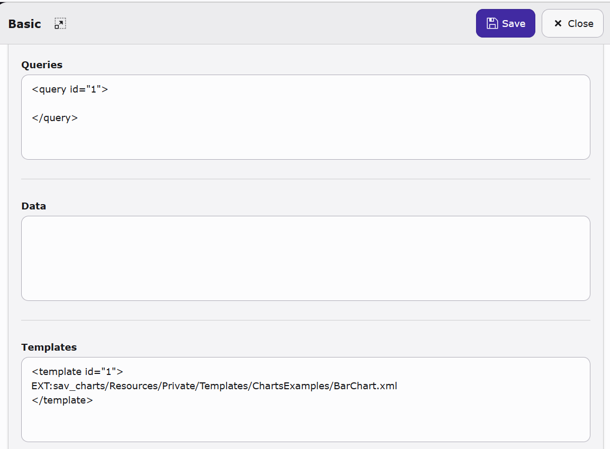
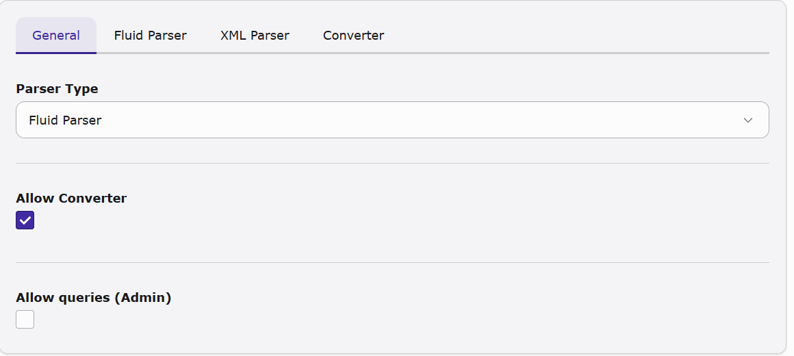
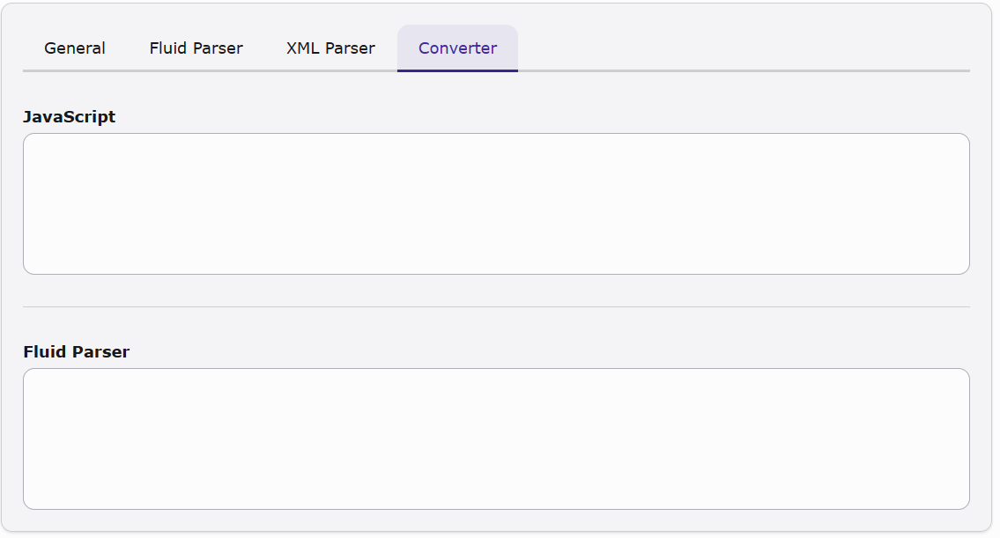

..  include:: ../../Includes.txt

..  _pluginInterface:

================
Plugin Interface
================

In layout mode, the SAV Charts plugins have a
modified header that provides extra information
about the parser being used and the possible
debug mode for the Fluid Parser.

    

General Tab
===========
This tab is for the general configuration settings. 
It includes selecting
the parser type and granting permission to use queries.
Only an admin user can grant permission to use queries.

If the parser type is set to `Fluid Parser`,
a checkbox becomes available to activate
the `Converter` tab.

Fluid Parser Tab
================

This tab is for the Fluid Parser configuration.
It contains fields for markers, queries, data, and templates, as well
as a debug feature. These fields provide an easy 
way to organize the code.

XML Parser Tab
==============

This tab is for the XML Parser configuration.
It contains all the fields from the second tab except
the debug feature.

Converter Tab
=============

This feature, introduced in SAV Charts 14.9.0, helps you
to cope with JavaScript examples available in
`Chart.js<https://www.chartjs.org/>`_,
`Apache ECharts<https://echarts.apache.org/>`_,
`ApexCharts<https://apexcharts.com/>`_, or
`Plotly <https://plotly.com/javascript/>`_.

Copy the JavaScript code from an example, paste
it into the JavaScript field, and then save it.
The converter will then provide the code, if possible, for
the Fluid Parser. See :ref:`Using the converter <UsingTheConverter>`
in the tutorial section.

