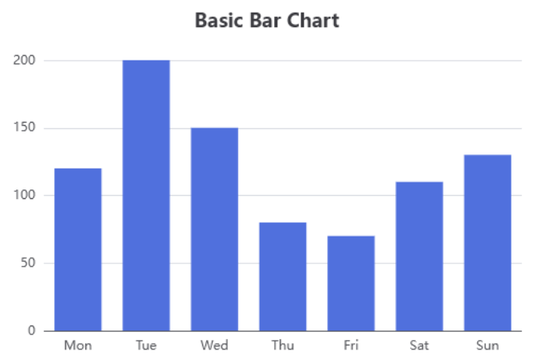
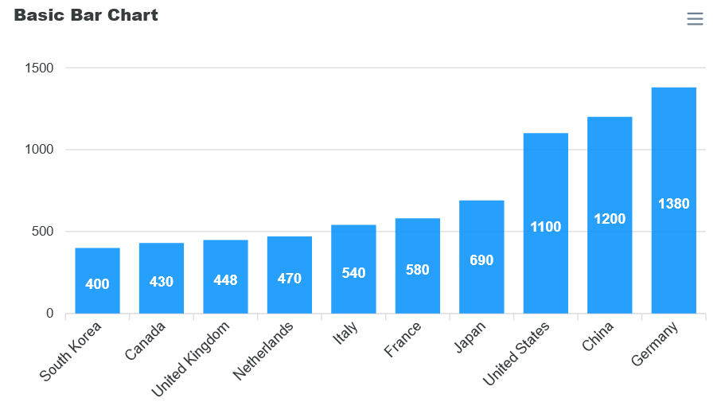
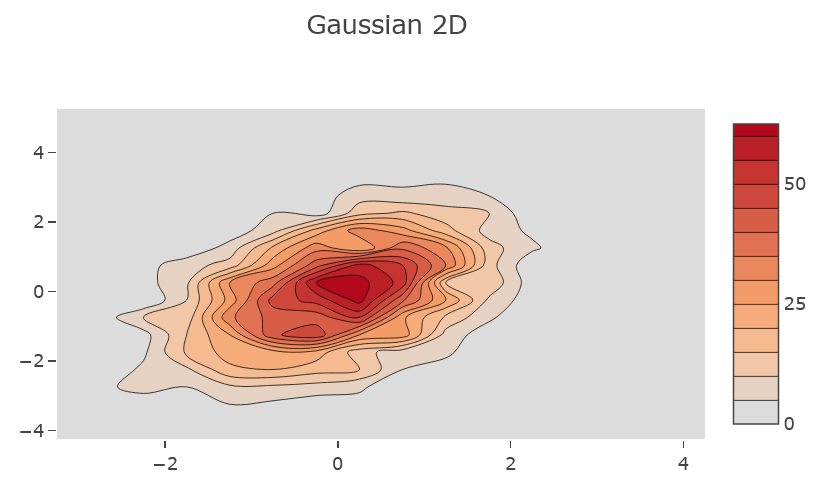
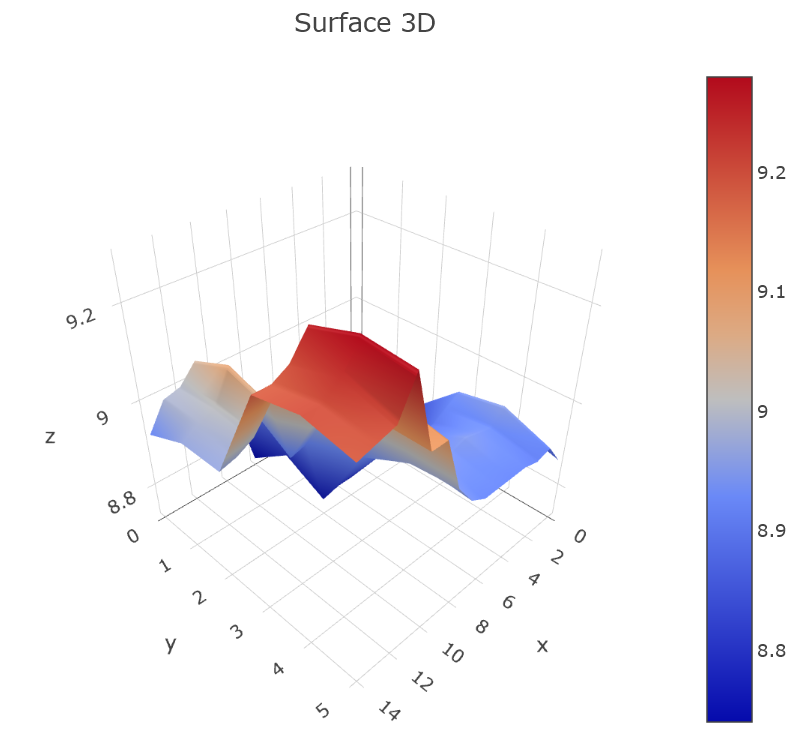

..  include:: ../../Includes.txt

..  _UsingOtherLibrariesTutorial:

=====================
Using Other Libraries
=====================

All the concepts used
in `Charts.js` can be used with the following
libraries:

-   `Apache ECharts` was introduced
    in version 14.7.0 of SAV Charts.

-   `ApexCharts` was introduced
    in version 14.8.0. 

-   `Plotly` was introduced
    in version 14.9.0. 

Using Apache ECharts
====================

Charts must be created using the `<c:echarts>`
and its :ref:`children viewHelpers <echart>` instead of `<c:charts>` with `Charts.js`.

Several examples of basic charts are provided 
in the directory
:guilabel:`Resources/Private/Templates/EChartsExamples`.

All of the provided examples were
converted from the 
`ECharts Examples section <https://echarts.apache.org/examples/en/index.html>`_.
For instance, adding the following code in the
Template field of the plugin Flexform generates
a basic bar chart. 
 
..  code-block:: xml 
    
    <c:template id="1">
    EXT:sav_charts/Resources/Private/Templates/EChartsExamples/BarChart.fluid"
    </c:template>

Using ApexCharts
================

Charts must be created using the `<c:apexcharts>`
and its :ref:`children viewHelpers <apexchart>` instead of `<c:charts>` with `Charts.js`.

..  important::

    The Community Licence is free for individuals,
    non-profits, educators, and small businesses 
    with less than $2 million USD in annual 
    revenue. Please read `License Options for ApexCharts
    <https://apexcharts.com/license/>`_.

Several examples of basic charts are provided 
in the directory
:guilabel:`Resources/Private/Templates/ApexChartsExamples`.

All of the provided examples were
converted from the 
`ApexCharts JavaScript Chart Demos section <https://apexcharts.com/javascript-chart-demos>`_.
For instance, adding the following code in the
Template field of the plugin Flexform generates
a basic bar chart. 

..  code-block:: xml 
    
    <c:template id="1">
    EXT:sav_charts/Resources/Private/Templates/ApexChartsExamples/BarChart.fluid"
    </c:template>

Using Plotly Library
====================

Charts must be created using the `<c:plotlycharts>`
and its :ref:`children viewHelpers <plotlychart>` instead of `<c:charts>` with `Charts.js`.
       
Several examples of basic charts are provided 
in the directory
:guilabel:`Resources/Private/Templates/PlotlyChartsExamples`.

All of the provided examples were
converted from the 
`Plotly JavaScript Demos section <https://plotly.com/javascript/>`_.
For instance, adding the following code to the
`Template` field of the Flexform plugin generates
a basic bar chart. 

..  code-block:: xml 
    
    <c:template id="1">
    EXT:sav_charts/Resources/Private/Templates/PlotlyChartsExamples/BarChart.fluid"
    </c:template>

..  figure:: ../../Images/ScreenShots/PlotlyCharts/barChart.png
    :width: 60%   

It is also possible to generate more complex charts. For example,
adding the following code to the `Template` field of the 
Flexform plugin generates
a 2D contour chart, or a 3D surface chart
using data from the provided CSV spreadsheets.

..  code-block:: xml 
    
    <c:template id="1">
    EXT:sav_charts/Resources/Private/Templates/PlotlyChartsExamples/Gaussian2DChart.fluid"
    </c:template>

..  code-block:: xml 
    
    <c:template id="1">
    EXT:sav_charts/Resources/Private/Templates/PlotlyChartsExamples/Surface3DChart.fluid"
    </c:template>

